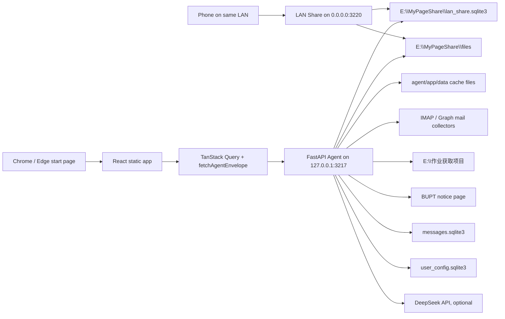

# Architecture

MyPage has two deliberately separate parts:

- a static browser start page in `frontend/`
- a local-only Python Agent in `agent/`
- an optional LAN Share server for same-network phone access

The frontend is optimized for fast personal use. The Agent is the boundary for local files, credentials, mailbox access, scheduled data, and automation scripts.

## High-Level Flow



The browser never receives secrets. It only receives normalized display data through Agent envelopes.

## Frontend

Stack:

- Vite
- React
- TypeScript
- Tailwind CSS
- TanStack Query
- Zustand
- react-grid-layout
- framer-motion
- lucide-react

Important files:

- `frontend/src/App.tsx`: top-level app composition.
- `frontend/src/app/AppShell.tsx`: wallpaper, time, search, settings, widget grid.
- `frontend/src/config/appConfig.ts`: static app configuration, search engines, default widgets.
- `frontend/src/config/types.ts`: widget and config types.
- `frontend/src/config/useEffectiveConfig.ts`: merges user config into static config.
- `frontend/src/store/useConfigStore.ts`: persisted user configuration.
- `frontend/src/store/useLayoutStore.ts`: persisted widget layout.
- `frontend/src/layout/defaultLayouts.ts`: default layout, normalization, restored-widget placement.
- `frontend/src/layout/WidgetGrid.tsx`: draggable/resizable widget grid.
- `frontend/src/widgets/registry.tsx`: maps widget `type` to React component.

### Persistent State

The frontend stores personal UI preferences in `localStorage`:

- `mypage-user-config-v2`: wallpaper, saved wallpapers, quick links, hidden widget ids.
- `mypage-widget-layouts`: react-grid-layout layouts for breakpoints.

These are intentionally client-side and personal, but they are now mirrored to the Agent as a trusted local backup. The browser cache remains the fast path; `agent/app/data/user_config.sqlite3` is the recovery source when a browser profile, origin, or extension context loses state.

### Widget Layout

Default layout comes from each widget's `layout` in `appConfig.ts`.

When a widget is restored from Settings:

1. Settings calls `appendWidgetLayout`.
2. `appendWidgetToLayouts` finds the bottom of currently visible widgets.
3. The restored widget is placed after that bottom.
4. The restored widget keeps its default `w`, `h`, `minW`, and `minH`.

`WidgetGrid` sets `compactType={null}` so the grid does not automatically squeeze restored widgets into old holes.

## Local Agent

Stack:

- Python
- FastAPI
- SQLite for message state
- JSON files for lightweight caches

Important files:

- `agent/app/main.py`: FastAPI app, CORS, background mail sync.
- `agent/app/api/widgets.py`: public local API routes.
- `agent/app/share_main.py`: separate LAN Share FastAPI app bound by script to `0.0.0.0:3220`.
- `agent/app/services/cache.py`: envelope and cache file helpers.
- `agent/app/services/lan_share.py`: PIN, token, shared text/file storage, LAN URL discovery.
- `agent/app/services/message_pipeline.py`: mail collectors, DeepSeek analysis, notification center.
- `agent/app/services/course_schedule.py`: fixed term schedule reader and Today widget data.
- `agent/app/services/homework.py`: BUPT homework JSON reader and silent manual refresh.
- `agent/app/services/school_notices.py`: BUPT school notice fetch, relevance filtering, dismiss state.
- `agent/app/services/user_config.py`: trusted local backup for user configuration and layout snapshots.
- `agent/app/services/link_icons.py`: link icon resolver, local icon registry, and favicon cache.
- `agent/app/sample_data.py`: fallback sample data.

The Agent binds to `127.0.0.1:3217`. It should not be exposed on a public network.

When `frontend/dist/index.html` exists, the Agent also serves the production start page at:

```txt
http://127.0.0.1:3217/
```

This URL is intended for the browser startup page. The Chrome/Edge unpacked extension still owns the new-tab page.

## LAN Share Service

LAN Share is intentionally separate from the main Agent:

- main Agent: `127.0.0.1:3217`, private desktop API, full widget and local-data access
- Share server: `0.0.0.0:3220`, small phone-facing API, only shared text/files

The Share server is started with:

```powershell
.\scripts\start-share.ps1
```

The desktop Share widget talks to the main Agent at `3217`, which can display the current PIN, detected LAN URLs, and recent shared items. Phones talk directly to `3220` and must authenticate with the 6-digit PIN. Successful PIN auth returns a short-lived bearer token stored in the phone browser's local storage.

The shared data lives outside the repository:

```txt
E:\MyPageShare\lan_share.sqlite3
E:\MyPageShare\files\
```

This keeps phone-uploaded files and clipboard history out of Git and out of the main `agent/app/data` private config area. The default maximum file size is 200 MB and can be overridden with `MYPAGE_SHARE_MAX_FILE_BYTES`.

LAN Share should stay LAN-only. Do not bind the main Agent to `0.0.0.0`, and do not port-forward `3220` to the public internet.

## Agent Envelope

Every widget endpoint should return:

```json
{
  "updatedAt": "2026-06-24T02:00:00+08:00",
  "stale": false,
  "error": null,
  "data": {}
}
```

The frontend treats `stale` and `error` as display states, not fatal app errors.

## Current API Surface

Basic:

- `GET /health`
- `GET /`

Configuration backup:

- `GET /api/config/load`
- `POST /api/config/save`
- `GET /api/config/snapshots`
- `POST /api/config/snapshots/{snapshot_id}/restore`

Static/cache-backed widgets:

- `GET /api/school/today`
- `GET /api/github/contributions`
- `GET /api/codex/usage/today`
- `GET /api/automation/digest`
- `GET /api/scripts/status`

LAN Share, desktop/local side:

- `GET /api/share/status`
- `GET /api/share/items`
- `POST /api/share/text`
- `POST /api/share/files`
- `GET /api/share/files/{item_id}`
- `POST /api/share/files/{item_id}/reveal`
- `POST /api/share/files/{item_id}/copy`
- `POST /api/share/items/{item_id}/delete`
- `POST /api/share/clear`
- `POST /api/share/reset-pin`

LAN Share, phone-facing service on `3220`:

- `GET /share`
- `GET /api/share/status`
- `POST /api/share/auth`
- `GET /api/share/items`
- `POST /api/share/text`
- `POST /api/share/files`
- `GET /api/share/files/{item_id}`
- `DELETE /api/share/items/{item_id}`
- `POST /api/share/clear`

Weather:

- `GET /api/weather/summary`
- `POST /api/weather/refresh`
- `GET /api/weather/settings`
- `POST /api/weather/settings`

Link icons:

- `GET /api/link-icons/resolve?href=...`
- `POST /api/link-icons/cache`
- `GET /api/link-icons/files/{file_name}`

Homework:

- `GET /api/homework/due`
- `POST /api/homework/refresh`

School notices:

- `GET /api/school/notices`
- `POST /api/school/notices/refresh`
- `GET /api/school/notices/status`
- `POST /api/school/notices/{notice_id}/dismiss`

Mail and notifications:

- `GET /api/mail/summary`
- `GET /api/mail/messages?view=priority|unread&limit=100`
- `POST /api/mail/refresh`
- `POST /api/mail/messages/{message_id}/dismiss`
- `GET /api/notifications`

Microsoft Graph support:

- `GET /api/mail/microsoft/status`
- `POST /api/mail/microsoft/device/start`
- `POST /api/mail/microsoft/device/poll`

## Data Storage

Ignored local runtime data:

- `agent/app/data/mail_accounts.json`
- `agent/app/data/oauth_tokens.json`
- `agent/app/data/messages.sqlite3`
- `agent/app/data/user_config.sqlite3`
- `agent/app/data/course_schedule.json`
- `agent/app/data/link_icons.sqlite3`
- `agent/app/data/link-icons/`
- `agent/app/data/weather_cache.json`
- `agent/app/data/weather_settings.json`
- other `agent/app/data/*.json`

LAN Share runtime data, outside this repository:

- `E:\MyPageShare\lan_share.sqlite3`
- `E:\MyPageShare\files\`

Committed templates:

- `agent/mail_accounts.example.json`
- `agent/.env.example`
- `agent/app/data/.gitkeep`

## External Integrations

### Config Backup

The frontend keeps `localStorage` as a fast cache, but the Agent is the trusted local backup for user data. The backed-up config includes:

- links
- wallpapers
- hidden widget ids
- widget layouts
- sticky note
- selected search engine

`ConfigBackupSync` loads Agent backup at startup. If Agent data is newer, it restores frontend stores. If local data is newer or no Agent backup exists, it saves local data to Agent. Later changes are saved back to Agent with a short debounce.

The Agent stores the current config in `user_config.sqlite3` and snapshots previous versions before each save. The Settings Backup tab can export, import, refresh status, and restore the latest snapshot.

### Link Icons

Quick links store only user intent:

- `id`
- `label`
- `href`
- `category`

They do not store favicon URLs. Icons are derived cache data owned by the Agent.

### Weather

The weather widget is a local Agent integration rather than a browser-side API call. The frontend reads `GET /api/weather/summary`; manual refresh calls `POST /api/weather/refresh`.

Default location is BUPT in Beijing, with Beijing city kept as a second saved location. The first provider is Open-Meteo Forecast API, which does not require a local API key for personal use.

The Agent caches normalized weather in `agent/app/data/weather_cache.json` for 30 minutes. Cache data includes current conditions, the next 12 hours, 7 daily forecasts, and rule-based commute advice such as rain, cold, heat, wind, and UV reminders. If the external request fails but cache exists, the Agent returns cached data with `fromCache=true`.

Settings live in `agent/app/data/weather_settings.json` and include locations, active location, alert thresholds, and cache TTL. Future provider-specific secrets must stay in ignored runtime data or user environment variables, never in frontend code.

### School Notices

School notices are split into three responsibilities inside `agent/app/services/school_notices.py`:

- Portal auth state: `agent/app/data/school_portal_cookies.json` stores the current `JSESSIONID` plus metadata such as `capturedAt`, `lastValidatedAt`, `lastFailureType`, and the local session health window.
- Notice collection: the collector fetches the notice list and detail pages only after it has a usable portal cookie. It treats CAS/login pages, `authserver/login`, and portal error pages as authentication failures instead of valid HTML.
- Notice cache: `agent/app/data/school_notices.sqlite3` stores parsed notices, dismiss state, and sync state. Refresh failures keep the last successful data and expose typed status through `lastErrorType`.

The browser-facing refresh button should be understood as "try to update the local notice cache now". It is not the only source of truth for portal login state. If the cookie is missing, stale, or rejected by the portal, the Agent may invoke the homework project's Playwright login helper to refresh the portal session, then retry the notice request once.

`GET /api/school/notices/status` exists for diagnostics and future UI. It reports the visible notice count, total cached notices, last sync attempt, last successful sync, last error, and auth health without triggering a refresh.

The frontend renders icons through a stable URL:

```txt
/api/link-icons/resolve?href=https%3A%2F%2Fexample.com
```

The Agent normalizes the link host, looks up `agent/app/data/link_icons.sqlite3`, and returns the cached image file from `agent/app/data/link-icons/`. If there is no cached icon, the Agent fetches one, validates that the response is actually an image, stores it locally, records the registry row, and returns the image. If fetching fails and a previous icon exists, the previous icon stays in use. If no icon exists, the Agent generates a local fallback SVG.

This keeps user config stable when an icon changes from `.ico` to `.png` or when a site changes favicon paths. Do not add `icon`, `favicon`, or concrete `/api/link-icons/files/...` URLs back into `QuickLink` or config backup.

### Mail

QQ is collected directly through IMAP. Outlook is collected directly through Microsoft Graph with device-code OAuth; forwarded-source inference is not part of the architecture.

Mail analysis:

- DeepSeek analyzes new messages when `DEEPSEEK_API_KEY` is present.
- A local keyword fallback keeps the UI usable without DeepSeek.
- A versioned local safety policy runs after AI analysis. Billing, security, account, and service-change mail cannot remain low priority because of a single model decision.
- The compact widget shows priority unread mail. The expanded widget can switch between priority and all non-dismissed unread mail.
- IMAP collection reconciles recent, server-unread, and locally known unread UIDs. Graph collection merges recent Inbox messages with server unread messages and reconciles handled local items.
- Low-signal mail and manually dismissed mail are hidden from the compact Mail widget. A manual dismiss is local and permanent in MyPage; it does not mutate the mailbox.
- Important mail is copied into the shared notification center.
- Accounts can opt into conservative marketing cleanup with `marketingAction: "trash"`. IMAP uses atomic UID `MOVE`; Graph updates `isRead` and moves to `deleteditems`. Only messages where AI and deterministic rules agree are processed, and MyPage never permanently deletes or sends mail.

### Homework

Homework data is read from `E:\作业获取项目\homework_db.json` by default.

Manual refresh uses a silent inline wrapper around the homework project's core functions. It updates the local state file but does not call the homework project's `Notifier`, so it does not send email, desktop notifications, markdown, webhook, WeChat, or PushPlus messages.

### School Notices

School notices are fetched from the BUPT portal notice list. This is separate from the ucloud homework API: `E:\作业获取项目\valid_headers.json` contains `blade-auth` / `authorization` headers for homework requests and cannot directly authenticate `my.bupt.edu.cn`.

The Agent stores portal cookies in `agent/app/data/school_portal_cookies.json`. When those cookies are missing or expired, the current implementation reuses the homework project's login-form helper and Playwright to log into the BUPT portal and capture a fresh `JSESSIONID`.

The service parses notice links, extracts dates and detail text, scores relevance for student-facing notices, hides low relevance items, and stores dismiss state locally under `agent/app/data/`.

## Extension Mode

The frontend can be built and loaded as an unpacked Chrome/Edge extension. Dynamic widgets still depend on the local Agent at `127.0.0.1:3217`; without the Agent, widgets show unavailable or sample states while the static page remains usable.
